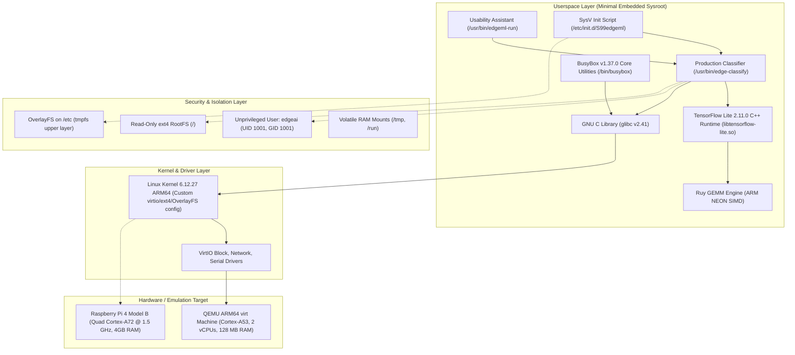

# Track A — Application-Specific Linux Distribution for Edge ML Inference

> **A custom, minimal, and secure embedded Linux operating system built with Buildroot 2025.02.10 LTS and Linux Kernel 6.12.27, purpose-engineered for INT8 quantized deep learning vision inference at the edge.**

---

## 1. Project Title
**Track A: Application-Specific Linux Distribution for Edge ML Inference**  
Reference Hardware: Raspberry Pi 4 Model B (Broadcom BCM2711, Quad-core Cortex-A72 @ 1.5 GHz, 4GB RAM)  
Emulation Target: QEMU ARM64 `virt` Machine (Cortex-A53, 2 vCPUs, 128 MB RAM)

---

## 2. Project Overview
General-purpose Linux distributions (such as Ubuntu Server or standard Raspberry Pi OS) are designed to support a wide variety of hardware accessories, desktop environments, multi-user sessions, and general computing workloads. Consequently, they include background services, package managers, diagnostic logging, and substantial memory overhead that are unnecessary—and often detrimental—for dedicated edge appliances.

This project designs and implements an application-specific embedded Linux operating system built from source using **Buildroot 2025.02.10 LTS**. The system is stripped of all non-essential components, incorporates a hardened **Read-Only Root Filesystem with an ephemeral OverlayFS**, isolates execution to an **unprivileged `edgeai` system user**, and embeds the **TensorFlow Lite 2.11.0 C++ runtime** optimized with ARM NEON acceleration. The entire operating system, kernel, and production inference engine run in under **13 MB of idle RAM** and cold boots in **~16.77 seconds** under QEMU software emulation.

---

## 3. Problem Statement
Deploying deep learning vision workloads to resource-constrained edge devices presents three major systems-level bottlenecks:
1. **Operating System Bloat & Resource Starvation:** Standard distributions consume 150 MB–300 MB of RAM at idle and run 80+ background daemons (`systemd`, `dbus`, `cron`, `udev`, `logind`), starving ML models of memory and compute cycles.
2. **Flash Storage Degradation & Corruption:** Unscheduled power interruptions while the operating system writes logs or journal transactions to SD/eMMC storage cause corruption and boot failures.
3. **Broad Attack Surface & Privilege Misconfiguration:** Embedded appliances often run workloads as `root`, exposing device control and host peripherals if network interfaces are compromised.

---

## 4. Objectives
- **Minimal Footprint:** Reduce root filesystem content size by $>90\%$ and idle RAM by $>80\%$ compared to a stock Linux baseline.
- **High-Performance Inference:** Achieve single-thread MobileNetV2 INT8 latency $<500\text{ ms}$ and multi-thread latency $<300\text{ ms}$ under QEMU ARM64 emulation with linear multi-core scaling.
- **Robust Storage Reliability:** Eliminate SD-card write wear and sudden-power-cut corruption via a mount-time read-only rootfs (`/`) and volatile RAM-backed OverlayFS on `/etc`.
- **Privilege Separation:** Guarantee that image ingestion and model inference execute strictly under an unprivileged user (`edgeai`, UID 1001) with login disabled.
- **Deterministic & Reproducible Build:** Deliver out-of-tree Buildroot defconfigs, cryptographically pinned source archives, and SHA-256 manifests.

---

## 5. Key Features
- **Application-Specific Design:** Only 23 built target packages (12 core functional software packages); zero package manager overhead (`dpkg`/`apt` omitted).
- **Hardened Root Filesystem:** Root partition mounted `ro` at kernel VFS level. Volatile mounts (`/tmp`, `/run`) use `tmpfs`.
- **OverlayFS Configuration Layer:** Ephemeral upper directory on `/etc` backed by `tmpfs` allows safe runtime configuration changes without persisting writes to flash.
- **Embedded C++ Production Classifier (`edge-classify`):** Standalone zero-dependency C++17 image classification application with custom PPM P3/P6 image parser, bilinear resizer, and quantizer.
- **Usability Assistant (`edgeml-run`):** Developer CLI wrapper with automatic model and label path resolution, image listing, and top-K parameter handling.
- **SysV Boot Service (`S99edgeml`):** Fail-safe boot integration (disabled by default in `/etc/default/edgeml`) capable of non-blocking background inference on boot.

---

## 6. System Architecture



---

## 7. Technology Stack
- **Build System:** Buildroot 2025.02.10 LTS
- **Linux Kernel:** Linux 6.12.27 (ARM64 custom defconfig)
- **C Library:** GNU C Library (`glibc`) 2.41
- **Cross-Toolchain:** GCC 13.4.0, GNU Binutils 2.43.1, Linux 6.12 UAPI headers
- **Core Utilities & Init:** BusyBox 1.37.0 (SysV init `/etc/init.d/rcS`)
- **Machine Learning Engine:** TensorFlow Lite 2.11.0 (C++ API)
- **Matrix Kernels:** Ruy GEMM Engine with ARM NEON vectorization
- **Model Serialization:** FlatBuffers 24.12.23
- **Primary Model:** MobileNetV2 INT8 Quantized (`mobilenet_v2_1.0_224_quant.tflite`, 3.4 MB)
- **Emulation & Virtualization:** QEMU 8.2+ (`qemu-system-aarch64`)

---

## 8. Repository Structure

```text
OS_Project_Track_A/
├── README.md                           # Main project documentation and quickstart
├── PROJECT_STATUS.md                   # Real-time development progress and phase log
├── SHA256SUMS.txt                      # Cryptographic checksum manifest of all project files
├── .gitignore                          # Git exclusions (build outputs, 4GB QCOW2 disks)
├── configs/
│   ├── qemu_aarch64_virt_edgeml_defconfig   # Validated QEMU ARM64 Buildroot defconfig
│   ├── raspberrypi4_64_edgeml_defconfig     # Target Raspberry Pi 4 Model B defconfig
│   └── users_table.txt                 # Buildroot user table provisioning user 'edgeai'
├── deliverables/
│   ├── build_manifest.md               # Detailed system build manifest
│   ├── SHA256SUMS.txt                  # Checksums copy for deliverables bundle
│   ├── package-manifest.json           # Buildroot show-info package and license export
│   ├── config/                         # Saved kernel and Buildroot configurations
│   ├── images/                         # Release deliverables (kernel Image, rootfs.ext2)
│   └── benchmarks/                     # Consolidated test logs and verification reports
├── docs/
│   ├── final_project_report.md         # Comprehensive engineering project report
│   ├── requirements.md                 # Detailed requirements specification
│   ├── architecture.md                 # Architectural blueprints and Mermaid models
│   ├── benchmarks.md                   # Comparative evaluation vs Stock Debian 13
│   ├── reproducibility.md              # Rebuild verification & bit-for-bit determinism
│   └── phase7_system_evaluation.md     # Phase 7 integration and verification suite
├── ml_model/
│   ├── mobilenet_v2_1.0_224_quant.tflite  # Production INT8 quantized MobileNetV2 model
│   ├── imagenet_labels.txt             # 1001 ImageNet classification category labels
│   └── mobilenet_v2_1.0_224_quant_info.txt # Model input/output tensor metadata
├── rootfs/                             # Target root filesystem overlay tree
│   ├── etc/
│   │   ├── default/edgeml              # Boot-time service configuration
│   │   ├── fstab                       # Read-only rootfs and tmpfs mount table
│   │   ├── inittab                     # BusyBox init table with read-only guard
│   │   └── init.d/
│   │       ├── S00overlay              # Ephemeral OverlayFS mounting script
│   │       └── S99edgeml               # Edge ML SysV service script
│   └── usr/bin/
│       └── edgeml-run                  # Developer usability assistant CLI script
├── scripts/
│   ├── build.sh                        # Master build helper script with PATH cleaner
│   ├── check_host_env.sh               # Host prerequisite package verification tool
│   ├── generate_test_images.py         # Test image generator for PPM P3/P6 formats
│   └── phase7_verify.sh                # Automated 15-test verification harness
└── src/
    ├── Makefile                        # Cross-compilation Makefile for edge-classify
    ├── edge_classify.cpp               # Production C++ inference engine source
    ├── image_loader.h / .cpp           # Zero-dependency PPM image parser
    └── image_preprocessor.h / .cpp     # Bilinear resize and INT8 quantization engine
```

---

## 9. Hardware Requirements

### Reference Edge Target
- **Board:** Raspberry Pi 4 Model B
- **SoC:** Broadcom BCM2711 (Quad-core ARM Cortex-A72 @ 1.5 GHz)
- **RAM:** 4 GB LPDDR4-3200 SDRAM
- **Storage:** 16 GB or 32 GB Class 10 / A1 MicroSD Card
- **Power:** 5V / 3A DC via USB-C (Official 15.3W Power Supply)

### Emulation Hardware (Evaluated Platform)
- **Virtual CPU:** ARM Cortex-A53 (2 vCPUs)
- **Virtual Machine:** QEMU `virt` platform
- **Allocated RAM:** 128 MB RAM (verifies minimal footprint)
- **Virtual Storage:** VirtIO Block Device (`/dev/vda`)

---

## 10. Software Requirements

### Host Build Environment
- **Host OS:** Ubuntu 24.04 LTS (native or WSL2)
- **Host Tools:** GNU Make $\ge 4.0$, GCC $\ge 11.0$, G++ $\ge 11.0$, Git, CMake $\ge 3.18$, Python 3, Bison, Flex, rsync, cpio, unzip, wget, bc
- **Host Emulators:** `qemu-system-aarch64` $\ge 8.0$

Verify all host prerequisites automatically:
```bash
./scripts/check_host_env.sh
```

---

## 11. Build Environment Setup

1. **Clone the Repository:**
   ```bash
   git clone <repository_url> OS_Project_Track_A
   cd OS_Project_Track_A
   ```

2. **Verify Host Tools & Tarballs:**
   ```bash
   ./scripts/check_host_env.sh
   ```

3. **Verify Buildroot Release Archive:**
   Ensure `buildroot/buildroot-2025.02.10.tar.gz` matches SHA-256 `f3de928ed368ef3dcadb97d4f4c1a9f49424a367759dba1d97c4c2bc5a22eab1`. If unextracted:
   ```bash
   tar -xzf buildroot/buildroot-2025.02.10.tar.gz -C buildroot/
   ```

---

## 12. Buildroot Configuration

The project utilizes out-of-tree Buildroot configuration to maintain a clean source tree:

```bash
# Configure for QEMU ARM64 Emulation Target:
./scripts/build.sh configure qemu

# Verify core configuration parameters:
./scripts/build.sh check-config qemu
```

To configure for the physical Raspberry Pi 4 Model B hardware target:
```bash
./scripts/build.sh configure rpi4
```

---

## 13. Building the Custom Linux OS

To trigger cross-compilation of the cross-toolchain, Linux kernel, TensorFlow Lite runtime, BusyBox, and root filesystem:

```bash
# Build using 4 parallel jobs (default):
./scripts/build.sh build qemu 4
```

Build outputs are generated in `output_qemu/images/`:
- `Image`: Uncompressed 64-bit ARM Linux Kernel 6.12.27 (11.86 MB)
- `rootfs.ext4`: Ext4 root filesystem partition image (60.00 MB allocated, 21.60 MB content)

---

## 14. Running the OS in QEMU

Launch the custom OS directly using the built-in helper:

```bash
./scripts/build.sh run-qemu
```

### Manual QEMU Invocation Command
```bash
qemu-system-aarch64 \
    -M virt \
    -cpu cortex-a53 \
    -nographic \
    -m 128M \
    -smp 2 \
    -kernel output_qemu/images/Image \
    -append "rootwait root=/dev/vda console=ttyAMA0" \
    -netdev user,id=eth0 \
    -device virtio-net-device,netdev=eth0 \
    -drive file=output_qemu/images/rootfs.ext4,if=none,format=raw,id=hd0 \
    -device virtio-blk-device,drive=hd0
```

* **Login:** `root` (no password required on local serial console).
* **Exit QEMU:** Press `Ctrl + A`, release, then press `X`.

---

## 15. Running the Image Classification Application

The production application [`/usr/bin/edge-classify`](src/edge_classify.cpp) executes directly on the target:

```bash
# Basic inference (single image, default 5 predictions):
/usr/bin/edge-classify --image /usr/share/edgeml/images/sample.ppm

# Multi-threaded benchmark (2 threads, 10 iterations):
/usr/bin/edge-classify --image /usr/share/edgeml/images/sample.ppm --threads 2 --benchmark 10

# Top-3 predictions with custom model:
/usr/bin/edge-classify --model /usr/share/edgeml/models/mobilenet_v2_1.0_224_quant.tflite \
                       --labels /usr/share/edgeml/models/imagenet_labels.txt \
                       --image /usr/share/edgeml/images/sample.ppm --top 3
```

---

## 16. Inference Service Usage

### High-Usability CLI Assistant (`edgeml-run`)
```bash
# List available sample images:
edgeml-run -l

# Run inference on sample image:
edgeml-run sample.ppm

# Run multi-threaded benchmark:
edgeml-run sample.ppm --threads 2 --benchmark 15
```

### Boot Service Management (`/etc/init.d/S99edgeml`)
```bash
# Check service status and last execution log:
/etc/init.d/S99edgeml status

# Trigger an immediate on-demand inference pass as unprivileged user 'edgeai':
/etc/init.d/S99edgeml run

# Enable boot-time inference:
# Edit /etc/default/edgeml (via OverlayFS) and set EDGEML_ENABLED="yes"
```

---

## 17. Testing Instructions

An automated 15-test verification suite tests system integration, security permissions, error handling, and inference accuracy:

```bash
# Run the complete test suite from host:
./scripts/phase7_verify.sh
```

**Verification Results: 15/15 PASS (0 Failures)**
- Test 01: Boot Service Integration — PASS
- Test 02: Usability Helper (`edgeml-run`) — PASS
- Test 03: Unprivileged User Execution (`edgeai` UID 1001) — PASS
- Test 04: Service On-Demand Trigger — PASS
- Test 05: Defensive Error Handling (Invalid Model) — PASS (`EXIT_MODEL_ERR:2`)
- Test 06: Defensive Error Handling (Invalid Image) — PASS (`EXIT_IMG_ERR:6`)
- Test 07: Defensive Error Handling (Invalid Threads) — PASS (`EXIT_THREAD_ERR:1`)
- Test 08: Reliability (10x Consecutive Inferences) — PASS (Constant VmRSS)
- Test 09: Performance (1-Thread Benchmark) — PASS
- Test 10: Performance (2-Thread Benchmark) — PASS
- Test 11: Phase 5 Backward Compatibility (`tflite_test`) — PASS
- Test 12: Phase 6 Backward Compatibility (P3 ASCII Image Ingestion) — PASS
- Test 13: Phase 4 Security (Read-Only Rootfs) — PASS (`ROOTFS_READONLY_OK`)
- Test 14: Phase 4 Security (OverlayFS on `/etc`) — PASS
- Test 15: Clean System Teardown & Poweroff — PASS

---

## 18. Benchmarking Instructions

To replicate the empirical evaluation against the stock Debian 13 baseline:

1. **Boot Custom OS in QEMU (128 MB RAM, 2 vCPUs):**
   ```bash
   ./scripts/build.sh run-qemu
   ```
2. **Execute Single-Thread Benchmark (20 iterations):**
   ```bash
   /usr/bin/edge-classify --image /usr/share/edgeml/images/sample.ppm --threads 1 --benchmark 20
   ```
3. **Execute Dual-Thread Benchmark (30 iterations):**
   ```bash
   /usr/bin/edge-classify --image /usr/share/edgeml/images/sample.ppm --threads 2 --benchmark 30
   ```
4. **Monitor Memory & CPU:**
   ```bash
   free -m
   top -b -n 3 -d 1
   ```

---

## 19. Security Features
1. **Immutable Root Filesystem:** Root partition is mounted `ro` at kernel VFS level. Any unauthorized file writes or modifications to system binaries fail immediately with `Read-only file system`.
2. **Ephemeral OverlayFS:** `/etc` uses an OverlayFS mount backed by `tmpfs` (`lowerdir=/run/overlay/etc_lower,upperdir=/run/overlay/etc_upper`). Runtime configuration changes reside purely in volatile RAM and are discarded on reboot.
3. **Least Privilege Principle:** Machine learning inference is isolated to user `edgeai` (`UID 1001`, `GID 1001`) with login disabled and no sudo permissions.
4. **Kernel Hardening:** Sysctl rules in `/etc/sysctl.d/99-security.conf` enforce restricted dmesg access (`kernel.dmesg_restrict=1`), disabled kexec (`kernel.kexec_load_disabled=1`), and SYN flood protection.

---

## 20. Reproducibility
- **Bit-for-Bit Application Determinism:** Cross-compiling `src/edge_classify.cpp` produces a binary whose stripped SHA-256 hash matches the release target binary **bit-for-bit** (`e04c77b7f240167d0de34259fa58626a4013c10b60876364a2a7fab6c971f03e`).
- **Kernel Image Determinism:** The compiled kernel matches `deliverables/images/Image` **bit-for-bit** (`493da3b0d1a85549947f334f8419c2517872dc7dd4394e2ad015cedc768717e0`).
- **Defconfig Identity:** Generating a clean `.config` from `configs/qemu_aarch64_virt_edgeml_defconfig` reproduces all 2,000+ Kconfig symbols identically.
- **Cryptographic Manifests:** Comprehensive SHA-256 sums are maintained in [`SHA256SUMS.txt`](SHA256SUMS.txt) and [`deliverables/build_manifest.md`](deliverables/build_manifest.md).

---

## 21. Results Summary

Empirical evaluation against a stock Debian GNU/Linux 13 (Trixie) baseline under matched QEMU ARM64 (Cortex-A53, 2 vCPUs) emulation:

| Metric | Stock Debian 13 Baseline | Custom Buildroot OS | Reduction / Advantage | Comparability Classification |
| :--- | :--- | :--- | :--- | :--- |
| **RootFS Content (du -sh)** | 2,414 MB | **21.60 MB** | **99.10% reduction** | Directly Equivalent |
| **RootFS Allocated (df -BM)**| 2,427 MB | **30.27 MB** | **98.75% reduction** | Directly Equivalent |
| **Raw Disk Footprint** | 3,825.4 MB (`.qcow2`) | **71.86 MB** (Image + ext4) | **98.12% reduction** | Architectural Comparison |
| **Boot Storage (/boot)** | 72.0 MB (`vmlinuz` + `initrd`) | **11.86 MB** (`Image`) | **83.53% reduction** | Directly Equivalent |
| **System Idle RAM** | 156 MB (`free -m`) | **13 MB** (`free -m`) | **91.67% reduction** (-143 MB) | Directly Equivalent |
| **Active Tasks at Rest** | 86 processes | **6 processes** | **93.02% reduction** (-80 tasks) | Directly Equivalent |
| **Boot Latency (to ready)** | 26.76 s (`systemd-analyze`) | **16.77 s** (`/proc/uptime`) | **37.33% faster** | Methodology-Adjusted |
| **Kernel Boot Phase** | 7.73 s | **~1.85 s** (compute time) | **76.07% faster** | Directly Equivalent |
| **Single-Thread Latency** | 448.33 ms (Avg) | **461.94 ms** (Avg) | +3.04% (Debian faster) | Directly Equivalent |
| **Dual-Thread Latency** | 259.77 ms (Avg) | **251.08 ms** (Avg) | **3.35% faster** (Custom OS) | Directly Equivalent |
| **Dual-Thread Max (Tail)** | 325.70 ms | **292.03 ms** | **10.34% lower maximum observed latency** | Directly Equivalent |
| **Dual-Thread Throughput** | 3.85 FPS | **3.98 FPS** | **+3.38% higher FPS** | Directly Equivalent |
| **Multi-Thread Scaling** | 1.73x speedup | **1.84x speedup** | **6.36% better scaling** | Directly Equivalent |
| **Process Resident RAM** | 13.95 MB (13,952 KB) | **13.30 MB** (13,624 KB) | **4.66% leaner** | Directly Equivalent |
| **Installed Packages** | 404 packages (`dpkg`) | **23 packages** (12 core) | **94.31% reduction** | Architectural Comparison |

---

## 22. Limitations
1. **Emulation vs Hardware:** All reported benchmarks were measured inside QEMU ARM64 software emulation. Physical hardware benchmarking on the Raspberry Pi 4B has not yet been established.
2. **RAM Allocation Disparity:** Stock Debian required 2,048 MB RAM to boot its EFI/systemd stack, whereas the custom OS booted cleanly in 128 MB RAM.
3. **Power & Thermal Instrumentation:** Dynamic SoC power consumption (Watts) and junction temperature (°C) require physical PMIC and USB-C inline power analyzers and cannot be emulated.

---

## 23. Future Scope
1. **Phase 8 Physical Hardware Deployment:** Compile Target A using `configs/raspberrypi4_64_edgeml_defconfig` (Kernel 6.6 LTS, BCM2711 DTB, VideoCore firmware, `sdcard.img`) and flash to physical Raspberry Pi 4B hardware.
2. **Hardware Benchmarking:** Instrument physical cold boot times via serial console (`picocom`), measure sustained thermal throttling via `vcgencmd get_throttled`, and record USB-C power draw under 4-thread continuous inference.
3. **Hardware Acceleration:** Integrate the TensorFlow Lite XNNPACK delegate with dedicated ARMv8.2-A dot-product instructions and evaluate GPU acceleration via Vulkan / VideoCore VI.
