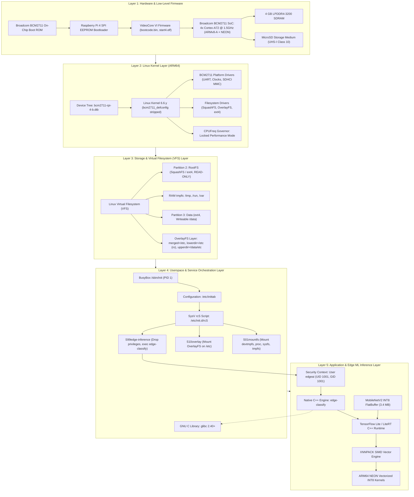
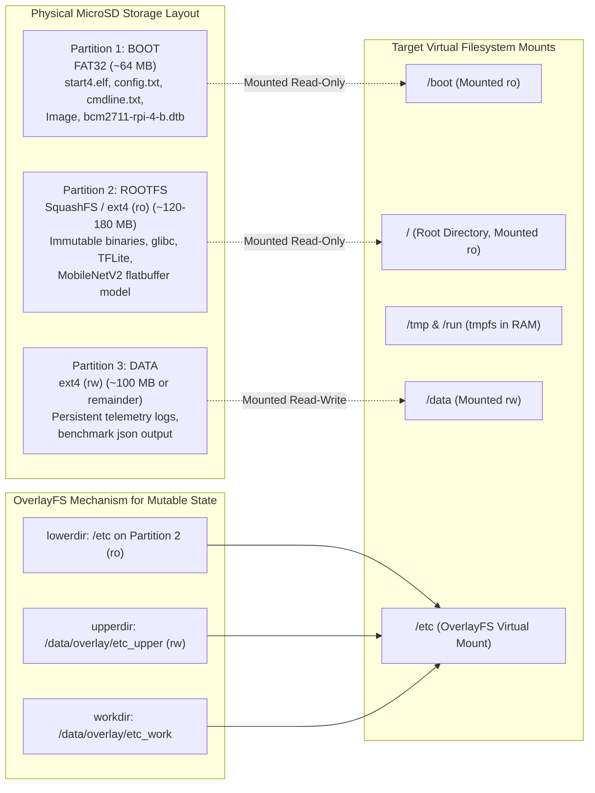
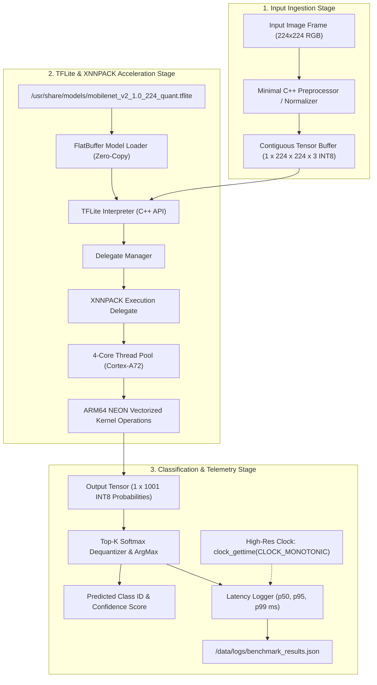
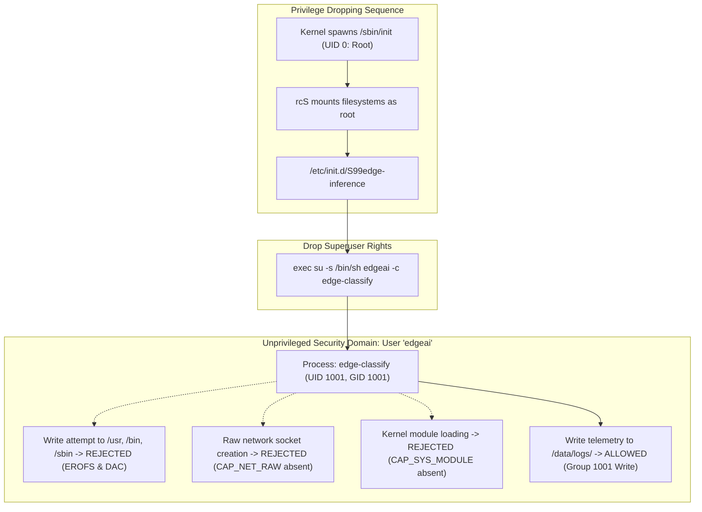

# System Architecture: Track A — Edge ML Linux OS

**Project Title:** Application-Specific Linux Distribution for ML Inference at the Edge  
**Track:** Track A (Target: Raspberry Pi 4 Model B, 4GB RAM — ARM64)  
**Document Version:** 1.0 (Phase 1: Requirements Analysis)  
**Status:** Approved for Implementation  
**Build System:** Buildroot 2025.02.10 LTS  

---

## 1. End-to-End System Architecture

The custom Edge ML Linux distribution is structured into distinct, decoupled architectural layers designed to ensure maximum determinism, minimal memory consumption, zero flash wear, and unprivileged ML execution.



---

## 2. Boot Flow & State Progression

The boot architecture is engineered to bypass all unnecessary multi-user targets and run-level transitions, launching the ML inference pipeline directly into memory within a target cold-boot window of under 4.5 seconds.

```mermaid
flowchart TD
    A["Power-On / Hardware Reset"] --> B["Stage 1: BCM2711 On-Chip ROM probes SPI EEPROM"]
    B --> C["Stage 2: SPI EEPROM initializes LPDDR4 memory controller and MMC"]
    C --> D["Stage 3: VideoCore VI executes start4.elf firmware from FAT32 boot partition"]
    D --> E["Firmware loads config.txt, cmdline.txt, bcm2711-rpi-4-b.dtb, and kernel Image"]
    E --> F["Firmware releases Cortex-A72 cores from reset at EL2"]
    F --> G["Stage 4: Linux Kernel 6.6.y initializes MMU, GIC-400, timers, and SDHCI"]
    G --> H["Kernel mounts RootFS partition /dev/mmcblk0p2 strictly READ-ONLY (ro)"]
    H --> I["Kernel executes PID 1: /sbin/init (BusyBox)"]
    I --> J["Stage 5: /sbin/init parses /etc/inittab and invokes /etc/init.d/rcS"]
    J --> K["rcS mounts /proc, /sys, /dev, and tmpfs on /tmp and /run"]
    K --> L["rcS initializes OverlayFS for mutable configuration state"]
    L --> M["Stage 6: /etc/init.d/S99edge-inference drops privileges to user edgeai"]
    M --> N["Executes native C++ binary /usr/bin/edge-classify"]
    N --> O["TFLite maps model flatbuffer, binds XNNPACK delegate, allocates tensors"]
    O --> P["Stage 7: Target Cold Boot Complete — 1st Inference Ready (< 4.5s Target)"]
```



---

## 3. Storage Partitioning & OverlayFS Architecture

To prevent filesystem degradation or data corruption during field power failures, the physical storage is segregated into three distinct partitions.



### Storage Characteristics
1. **Partition 1 (BOOT):** FAT32 formatted, contains only signed firmware, boot parameters, and the compressed kernel binary.
2. **Partition 2 (ROOTFS):** Read-only immutable block device. Any write attempt (`touch /usr/test`) triggers an immediate kernel VFS error (`EROFS: Read-only file system`). Flash memory cell wear is zero.
3. **Partition 3 (DATA):** Optional writable ext4 partition reserved exclusively for metric logging. An ungraceful power loss on `/data` will never prevent the operating system from booting or the inference engine from functioning.

---

## 4. Machine Learning Inference Pipeline Architecture

The edge classification pipeline is implemented in pure C++17 to avoid the multi-megabyte memory overhead and non-deterministic garbage collection cycles of Python.



---

## 5. Security & Privilege Separation Architecture

The operating system enforces the principle of least privilege across all user and system boundaries.



### Security Boundary Matrix

| Resource | Root (`UID 0`, Init Phase) | `edgeai` (`UID 1001`, Runtime Phase) | Protection Mechanism |
| :--- | :--- | :--- | :--- |
| **RootFS Partition (`/`)** | Read-Only | Read-Only (Forbidden by VFS) | VFS `MS_RDONLY` Mount Flag |
| **Application Binary (`/usr/bin`)** | Read-Execute (`0755`) | Read-Execute (`0555`) | Standard POSIX DAC |
| **Model Weight File** | Read-Only (`0644`) | Read-Only (`0444`) | Standard POSIX DAC |
| **Log Directory (`/data/logs`)** | Read-Write | Read-Write (`0775`) | Group Ownership `edgeai` |
| **Hardware Serial Console** | Direct Console Access | No Access | Restricted to root on `ttyAMA0` |
| **Network Interfaces** | Down / No Listener | No Access / No Sockets | No daemons listening |
| **Kernel Capabilities** | All Capabilities | `0` (Zero Capabilities) | Cleared during `su` privilege drop |

---

## 6. Buildroot Out-of-Tree Integration Design

To guarantee 100% build reproducibility and isolate generated binaries from tracked repository sources:

```
OS_Project_Track_A/
├── buildroot/
│   ├── buildroot-2025.02.10.tar.gz   # Pinned release source
│   └── buildroot-2025.02.10/          # Extracted Buildroot engine (gitignored)
├── configs/
│   └── raspberrypi4_64_edgeml_defconfig  # Pinned Buildroot configuration
├── rootfs/                            # Root filesystem overlay tree
│   ├── etc/
│   │   ├── inittab                    # BusyBox init configuration
│   │   ├── fstab                      # Mount declarations (ro rootfs, tmpfs)
│   │   └── init.d/
│   │       ├── rcS                    # Sysinit orchestrator
│   │       ├── S01mountfs             # Early VFS mounter
│   │       ├── S10overlay             # OverlayFS initialization
│   │       └── S99edge-inference      # Service startup & privilege dropper
│   └── usr/
│       └── share/models/              # MobileNetV2 INT8 model and label maps
├── scripts/
│   ├── check_host_env.sh              # Host audit tool
│   ├── build.sh                       # Wrapper: make O=output ...
│   └── run_benchmarks.sh              # Empirical measurement harness
└── output/                            # Out-of-tree build directory (gitignored)
    ├── build/                         # Package build directories
    ├── host/                          # Cross-toolchain (aarch64-buildroot-linux-gnu)
    ├── target/                        # Staged root filesystem
    └── images/                        # Final artifacts: Image, rootfs.ext4, sdcard.img
```

All build commands are executed out-of-tree using:
```bash
make -C buildroot/buildroot-2025.02.10 \
    O=$(pwd)/output \
    BR2_DEFCONFIG=$(pwd)/configs/raspberrypi4_64_edgeml_defconfig \
    defconfig
```
This guarantees clean separation, rapid cleaning (`rm -rf output/`), and immutable tracked configuration files.
