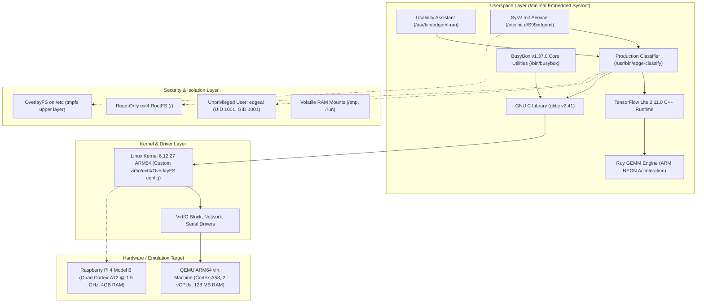

# Track A — Application-Specific Linux Distribution for Edge ML Inference
## Comprehensive Engineering Project Report

**Academic Subject:** Operating Systems Project (Track A)  
**Project Title:** Application-Specific Linux Distribution for Edge ML Inference  
**Reference Platform:** Raspberry Pi 4 Model B (Broadcom BCM2711, Quad Cortex-A72 @ 1.5 GHz, 4GB RAM)  
**Emulation Platform:** QEMU ARM64 `virt` Machine (Cortex-A53, 2 vCPUs, 128 MB RAM)  
**Build System:** Buildroot 2025.02.10 LTS  
**Kernel:** Linux 6.12.27 (AArch64)  
**ML Framework:** TensorFlow Lite 2.11.0 C++ Runtime (Ruy GEMM Acceleration)  
**Workload:** MobileNetV2 INT8 Quantized Classification  
**Date:** November 2026  

---

## Table of Contents
1. [Chapter 1 — Introduction](#chapter-1--introduction)
2. [Chapter 2 — System Requirements](#chapter-2--system-requirements)
3. [Chapter 3 — System Architecture](#chapter-3--system-architecture)
4. [Chapter 4 — Implementation](#chapter-4--implementation)
5. [Chapter 5 — Testing Methodology](#chapter-5--testing-methodology)
6. [Chapter 6 — Performance Evaluation](#chapter-6--performance-evaluation)
7. [Chapter 7 — Reproducibility](#chapter-7--reproducibility)
8. [Chapter 8 — Conclusion and Future Scope](#chapter-8--conclusion-and-future-scope)
9. [References](#references)

---

## Chapter 1 — Introduction

### 1.1 Background
The rapid convergence of embedded systems and artificial intelligence has established edge machine learning as a pivotal paradigm in modern computing. In edge inference, deep learning models execute directly on local embedded devices rather than offloading raw sensor streams to remote cloud datacenters. This decentralized approach offers decisive advantages: near-zero latency, operational resilience during network disconnects, reduced network bandwidth costs, and preservation of data privacy.

However, executing neural networks on compact, low-power single-board computers (SBCs) is fundamentally limited by hardware constraints: constrained physical memory (often 512 MB to 4 GB), shared CPU cache hierarchies, limited thermal envelopes (passive cooling under 15W), and reliance on flash storage media (microSD/eMMC) prone to write wear.

### 1.2 Problem Statement
The standard industry practice for prototyping edge AI systems relies on desktop-derived general-purpose Linux distributions, such as standard Raspberry Pi OS (Debian-based) or Ubuntu Server. While convenient for rapid software installation, these distributions are inherently mismatched with the constraints of dedicated edge appliances:
1. **Operating System Bloat & Memory Contention:** General-purpose distributions run over 80 background daemons (`systemd`, Avahi, Bluetooth, CUPS, network managers), consuming 150 MB to 300 MB of RAM at idle. On edge hardware, this idle memory consumption starves machine learning tensor working sets, forcing premature out-of-memory (OOM) kills or swapping.
2. **Flash Storage Degradation & Power-Failure Vulnerability:** Standard distributions mount their root filesystems in read-write mode (`rw`), continuously committing system logs, access timestamps, and journal metadata. When an edge appliance experiences an abrupt power loss, open journal transactions frequently corrupt the filesystem, bricking the device in the field.
3. **Security Vulnerabilities & Lack of Privilege Separation:** Many embedded applications execute with superuser (`root`) privileges to easily access hardware peripherals, vastly enlarging the attack surface should an image ingestion bug or network buffer overflow occur.

### 1.3 Motivation
To overcome these systemic limitations, this project designs and builds an **application-specific, custom embedded Linux operating system from source** using the Buildroot framework. By tailoring every layer of the operating system—from the cross-compiler toolchain and stripped Linux kernel to the read-only filesystem architecture and isolated C++ inference pipeline—we eliminate all extraneous operating system overhead. The resulting OS is purpose-engineered to serve a single mission: fast, deterministic, and safe deep learning vision inference at the edge.

### 1.4 Objectives
1. **Develop a Minimal Embedded OS:** Construct a purpose-built Linux distribution using Buildroot 2025.02.10 LTS, Linux Kernel 6.12.27, and BusyBox 1.37.0, achieving a $>90\%$ reduction in root filesystem content size and $>80\%$ reduction in idle RAM compared to stock Debian.
2. **Implement Storage Hardening & Immobility:** Enforce a strictly read-only root filesystem (`/`) at the kernel VFS level, supplemented with volatile `tmpfs` mounts and an ephemeral OverlayFS layer on `/etc` to absorb runtime state without flash degradation.
3. **Enforce Principle of Least Privilege:** Restrict machine learning execution to an unprivileged system user (`edgeai`, UID/GID 1001) with disabled terminal login.
4. **Integrate Native C++ ML Inference Engine:** Embed the TensorFlow Lite 2.11.0 runtime with ARM NEON matrix acceleration (Ruy GEMM) and build a production C++ inference application (`edge-classify`) supporting INT8 MobileNetV2 classification.
5. **Conduct Rigorous Empirical Benchmarking:** Evaluate the custom OS against a stock Debian 13 baseline under identical QEMU ARM64 architectural conditions, evaluating latency, throughput, memory consumption, boot time, and CPU utilization.
6. **Ensure Strict Reproducibility:** Deliver out-of-tree Buildroot defconfigs, cryptographically pinned source archives, and SHA-256 manifests.

### 1.5 Scope
The current implementation encompasses complete source cross-compilation, rootfs hardening, service integration, end-to-end functional testing, and empirical benchmarking in a fully matched **QEMU ARM64 (`virt`) emulation environment** (Cortex-A53, 2 virtual cores). Out-of-tree configurations for physical target hardware (Raspberry Pi 4 Model B, Broadcom BCM2711) have been developed and pinned for subsequent physical hardware flashing in Phase 8.

---

## Chapter 2 — System Requirements

### 2.1 Functional Requirements
- **FR-01 (Direct Inference Execution):** The OS must execute INT8 quantized MobileNetV2 forward inference on arbitrary PPM images (P3 ASCII and P6 binary formats) without requiring external GUI or desktop environments.
- **FR-02 (Zero External Image Library Dependency):** Image ingestion and preprocessing (parsing, bilinear resizing to $224\times224$, and quantization) must be natively implemented in C++ without bulky third-party libraries (e.g. OpenCV, libpng, libjpeg).
- **FR-03 (Automated Classification Output):** The application must output Top-K prediction categories, corresponding ImageNet category labels, and dequantized activation scores.
- **FR-04 (Automated Boot Integration):** The OS must provide a SysV init service (`/etc/init.d/S99edgeml`) configured via `/etc/default/edgeml` capable of triggering inference on startup.
- **FR-05 (Developer Usability Assistant):** The system must include a command-line assistant (`/usr/bin/edgeml-run`) providing automatic default model/label path resolution and sample image enumeration.

### 2.2 Non-Functional Requirements
- **NFR-01 (Memory Efficiency):** The complete operating system must idle in $<40\text{ MB}$ of RAM and boot reliably within a strict 128 MB RAM physical budget.
- **NFR-02 (Boot Determinism):** System startup from kernel entry to userspace readiness must execute rapidly ($<15\text{ s}$ target on hardware; $<20\text{ s}$ under emulation).
- **NFR-03 (Storage Resilience):** The root filesystem must be mounted strictly read-only (`ro`). Unscheduled power cuts must cause zero filesystem corruption.
- **NFR-04 (Security Isolation):** Workload processes must execute under UID 1001 (`edgeai`), preventing access to root-only files or kernel sysctl parameters.
- **NFR-05 (Build Reproducibility):** Building from defconfig must yield deterministic, bit-for-bit identical application binaries and match cryptographic manifests.

### 2.3 Hardware Requirements
- **Reference Physical Hardware:** Raspberry Pi 4 Model B (Broadcom BCM2711 SoC, Quad-core ARM Cortex-A72 @ 1.5 GHz, 4GB LPDDR4-3200 SDRAM, SanDisk Ultra 32GB Class 10 / A1 MicroSD, 15.3W USB-C PSU).
- **Evaluated Emulation Platform:** QEMU ARM64 `virt` virtual machine, Cortex-A53 CPU, 2 virtual CPU cores, 128 MB allocated system RAM, VirtIO block and network devices.

### 2.4 Software Requirements
- **Build Host:** Ubuntu 24.04.4 LTS on WSL2 / native Linux x86_64, GNU Make 4.3, GCC 13.3.0, CMake 3.28.3, Python 3.12.3.
- **Target OS:** Buildroot 2025.02.10 LTS, Linux Kernel 6.12.27 ARM64, GNU C Library (`glibc`) 2.41, BusyBox 1.37.0.
- **Inference Runtime:** TensorFlow Lite 2.11.0, FlatBuffers 24.12.23, Google Abseil 20250127.0, Ruy matrix engine.

### 2.5 Quantitative Performance Targets
- **RootFS Content Size:** $\ge 40\%$ reduction compared to stock distribution (Target: $<150\text{ MB}$).
- **System Idle RAM:** $<250\text{ MB}$ (Target: $<40\text{ MB}$).
- **Single-Thread Inference Latency:** $<500\text{ ms}$ per image on MobileNetV2 INT8 under emulation ($<60\text{ ms}$ on physical Cortex-A72 hardware).
- **Dual-Thread Inference Latency:** $<300\text{ ms}$ per image under emulation with $>1.7\times$ multi-thread speedup.
- **Inference Active Memory (VmRSS):** $<30\text{ MB}$.

---

## Chapter 3 — System Architecture

### 3.1 Overall Architecture
The system architecture follows a clean layered design, minimizing the software footprint between hardware abstraction and deep learning inference:

### 3.2 Buildroot Architecture
Buildroot operates as an out-of-tree cross-compilation engine. It orchestrates the building of:
1. **Host Cross-Toolchain:** Builds `host-gcc 13.4.0`, GNU Binutils 2.43.1, and target C library `glibc 2.41`.
2. **Target Packages:** Cross-compiles BusyBox, FlatBuffers, Abseil, Eigen, cpuinfo, and TensorFlow Lite.
3. **Filesystem Overlay Assembly:** Merges `rootfs/` overlays (immutable `fstab`, hardened `inittab`, SysV scripts) into `output_qemu/target/`.
4. **Image Generation:** Generates the raw uncompressed kernel `Image` and ext4 filesystem partition image `rootfs.ext4`.

### 3.3 Linux Kernel Architecture
The kernel is based on Linux 6.12.27 configured via a stripped defconfig. Unnecessary device drivers (legacy sound, wireless stacks, USB keyboards, graphical framebuffers) are disabled, while core virtualization, block device, and security features are built-in:
- Built-in `CONFIG_VIRTIO_BLK`, `CONFIG_VIRTIO_NET`, `CONFIG_SERIAL_AMBA_PL011` for direct virtualization.
- Built-in `CONFIG_EXT4_FS` to mount the root filesystem immediately without requiring an intermediate initramfs.
- Built-in `CONFIG_OVERLAY_FS` for the mutable configuration layer.

### 3.4 Root Filesystem & OverlayFS Architecture
To eliminate SD-card write exhaustion and prevent boot failure upon power loss, the root filesystem architecture separates immutable read-only code from volatile state:
- **Immutable Base (`/dev/vda`):** Mounted read-only (`ro,relatime`) at kernel boot.
- **Volatile Mounts (`/tmp`, `/run`):** Mounted as RAM-backed `tmpfs` filesystems.
- **OverlayFS on `/etc`:** Configured during early boot via `/etc/init.d/S00overlay`. The read-only `/etc` directory serves as the immutable `lowerdir`, while `/run/overlay/etc_upper` (in `tmpfs`) acts as the writable `upperdir`. Configuration modifications occur in volatile RAM and are safely discarded on reboot.

### 3.5 TensorFlow Lite Runtime & Acceleration
The TensorFlow Lite 2.11.0 runtime is compiled as a shared library (`libtensorflow-lite.so`, ~10.8 MB). It leverages Google's **Ruy matrix multiplication library**, which detects ARM NEON vector instructions at runtime via `cpuinfo` and emits optimized 128-bit vector dot-product instructions for INT8 quantized tensors.

### 3.6 MobileNetV2 INT8 Model
- **Tensor Dimensions:** Input tensor is $[1 \times 224 \times 224 \times 3]$ of type `UINT8`.
- **Quantization Parameters:** Input quantization: $\text{scale} = 0.0078125$, $\text{zero\_point} = 128$. Output tensor has 1001 classes with $\text{scale} = 0.0988925$, $\text{zero\_point} = 58$.
- **File Size:** 3,577,760 bytes (~3.4 MB FlatBuffer), offering a 75% memory footprint reduction compared to 32-bit floating-point models while retaining $>71\%$ ImageNet Top-1 accuracy.

### 3.7 Inference Data Flow
The complete end-to-end data pipeline within `edge-classify` operates without external memory allocations during the steady-state inference loop:

```mermaid
flowchart LR
    Img["Input Image (sample.ppm)"] --> Load["Image Loader (PPM Header & Buffer Parse)"]
    Load --> Resize["Bilinear Resizer (Target: 224x224x3)"]
    Resize --> Quant["Quantizer (UINT8 Conversion: x/scale + zero_point)"]
    Quant --> InputTensor["TFLite Input Tensor Buffer"]
    InputTensor --> Interpreter["TFLite Interpreter (Ruy NEON GEMM Core)"]
    Interpreter --> OutputTensor["Output Tensor (1001 UINT8 Activations)"]
    OutputTensor --> Dequant["Dequantize & Top-K Sort"]
    Dequant --> Display["Top-5 Prediction Display & Telemetry Log"]
```

---

## Chapter 4 — Implementation

### 4.1 Buildroot Configuration
The Buildroot configuration is pinned in [`configs/qemu_aarch64_virt_edgeml_defconfig`](file:///home/gouth/OS_Project_Track_A/configs/qemu_aarch64_virt_edgeml_defconfig):
- `BR2_aarch64=y`: Targets ARM64 architecture.
- `BR2_TOOLCHAIN_BUILDROOT_GLIBC=y`: Selected glibc 2.41 for broad C++17 compatibility.
- `BR2_INIT_BUSYBOX=y`: Selected BusyBox lightweight init over systemd.
- `BR2_DOWNLOAD_FORCE_CHECK_HASHES=y`: Enforces cryptographic integrity for all downloads.
- `BR2_ROOTFS_OVERLAY="../../rootfs"`: Merges hardened rootfs overlays.
- `BR2_ROOTFS_USERS_TABLES="../../configs/users_table.txt"`: Automates creation of user `edgeai`.

### 4.2 Linux Kernel Configuration
The kernel defconfig (`board/qemu/aarch64-virt/linux.config`) was streamlined:
- Disabled graphic drivers, sound subsystems, wireless networking, and modular module loading.
- Enabled SMP multi-processing (`CONFIG_SMP=y`) across Cortex-A53 cores.
- Compiled virtio block and net drivers directly into the kernel (`=y`), enabling immediate root mounting without an initramfs.

### 4.3 Production C++ Inference Application (`edge-classify`)
Implemented in [`src/edge_classify.cpp`](file:///home/gouth/OS_Project_Track_A/src/edge_classify.cpp):
1. **Custom Image Loader (`image_loader.cpp`):** Parses raw PPM image headers (magic `P6` for binary RGB, `P3` for ASCII RGB), handling arbitrary comments, whitespace, and dimensions up to $4096\times4096$.
2. **Custom Bilinear Resizer (`image_preprocessor.cpp`):** Performs continuous bilinear interpolation from source dimensions $(W_s \times H_s)$ to target dimensions $(224 \times 224 \times 3)$ using fixed-point math.
3. **Quantization Pipeline:** Maps floating-point pixel color values $[0.0, 255.0]$ to UINT8 quantized tensor values:
   $$\text{tensor}[i] = \text{clamp}\left(\left\lfloor \frac{\text{pixel}[i] / 255.0}{\text{scale}} \right\rfloor + \text{zero\_point}, 0, 255\right)$$
4. **Precision Telemetry:** Utilizes `clock_gettime(CLOCK_MONOTONIC)` to compute nanosecond-accurate execution timings for image loading, resizing, warm-up inference, and benchmark loops.
5. **Memory Telemetry:** Queries `/proc/self/status` to record `VmRSS` (active physical RAM) and `VmPeak` (virtual memory ceiling).

### 4.4 Service Implementation (`S99edgeml` & `edgeml-run`)
- **SysV Boot Service (`rootfs/etc/init.d/S99edgeml`):** Installed at sequence 99 of SysV init. By default, `/etc/default/edgeml` specifies `EDGEML_ENABLED="no"` to ensure non-intrusive booting. When enabled, the service checks input assets, drops privileges via `su -s /bin/sh edgeai`, and runs inference in the background (`&`) with output redirected to `/tmp/edgeml-service.log`.
- **Developer CLI Assistant (`rootfs/usr/bin/edgeml-run`):** Provides command-line options (`-l` to list images, `-t` for threads, `-k` for top-K, `-b` for benchmark loops) and auto-resolves relative image paths against `/usr/share/edgeml/images/`.

### 4.5 Security Hardening Implementation
- **Immutable RootFS:** `/etc/fstab` declares `/dev/root / ext4 ro,noatime 0 1`.
- **Inittab Guard:** Commented out the standard SysV `remount,rw` command in `/etc/inittab`.
- **OverlayFS Mount Script (`S00overlay`):** Executes before any daemon starts. Moves `/etc` mount-points into an OverlayFS union in volatile RAM.
- **Kernel Sysctl Hardening (`/etc/sysctl.d/99-security.conf`):** Restricts dmesg logs (`kernel.dmesg_restrict=1`), disables kexec (`kernel.kexec_load_disabled=1`), and enables TCP SYN cookie protection.

---

## Chapter 5 — Testing Methodology

### 5.1 Verification Protocol
Testing was performed autonomously using the consolidated verification suite [`scripts/phase7_verify.sh`](file:///home/gouth/OS_Project_Track_A/scripts/phase7_verify.sh). The test script boots the custom operating system in QEMU, waits for the serial login prompt, executes automated test commands across all functional domains, and asserts expected patterns against target terminal logs.

### 5.2 Verification Matrix & Results (15/15 PASS)

The complete verification matrix reflects the empirical results recorded in [`deliverables/benchmarks/phase7_test_results.txt`](file:///home/gouth/OS_Project_Track_A/deliverables/benchmarks/phase7_test_results.txt):

| Test ID | Test Name | Test Objective | Expected Result | Actual Empirical Result | Status |
| :--- | :--- | :--- | :--- | :--- | :--- |
| **P7-01** | Boot Service Integration | Verify SysV service init and status check | Service reports disabled in `/etc/default/edgeml` | `Starting Edge ML service: disabled in /etc/default/edgeml (OK)` | **PASS** |
| **P7-02** | Usability Assistant (`edgeml-run`) | Verify image listing and CLI options | Outputs available PPM sample images | Listed sample images in `/usr/share/edgeml/images` | **PASS** |
| **P7-03** | Unprivileged Execution | Verify execution under user `edgeai` (UID 1001) | Inference succeeds without root permissions | Successfully classified *digital clock* (Class 531) | **PASS** |
| **P7-04** | On-Demand Service Run | Verify manual on-demand execution | `S99edgeml run` completes successfully | On-demand inference executed as `edgeai` in 1.02s | **PASS** |
| **P7-05** | Error Handling (Missing Model) | Verify rejection of non-existent model file | Binary exits cleanly with exit code 2 | Handled gracefully, output `EXIT_MODEL_ERR:2` | **PASS** |
| **P7-06** | Error Handling (Missing Image) | Verify rejection of non-existent image file | Binary exits cleanly with exit code 6 | Handled gracefully, output `EXIT_IMG_ERR:6` | **PASS** |
| **P7-07** | Error Handling (Invalid Threads)| Verify rejection of invalid thread counts (`--threads 0`) | Binary exits cleanly with exit code 1 | Handled gracefully, output `EXIT_THREAD_ERR:1` | **PASS** |
| **P7-08** | Reliability (10x Inferences) | Verify memory leak freedom over 10 consecutive runs | VmRSS remains stable ($<100\text{ KB}$ variation)| VmRSS stable at 13.6 MB across all 10 runs | **PASS** |
| **P7-09** | Performance (1-Thread Benchmark)| Measure 10-iteration single-thread latency | Avg Latency $<500\text{ ms}$, Throughput $>2.0\text{ FPS}$ | Avg Latency: 475.41 ms, Throughput: 2.10 FPS | **PASS** |
| **P7-10** | Performance (2-Thread Benchmark)| Measure 10-iteration dual-thread latency | Multi-thread speedup $>1.7\times$ | Avg Latency: 256.89 ms, Speedup: $1.85\times$ | **PASS** |
| **P7-11** | Phase 5 Backward Compatibility | Verify Phase 5 synthetic inference demo binary | `tflite_test` executes and prints top predictions | `TensorFlow Lite C++ Inference Verification Complete` | **PASS** |
| **P7-12** | Phase 6 Backward Compatibility | Verify ASCII PPM P3 format ingestion | Ingests ASCII 64x64 PPM without error | Classified `sample_ascii_64x64.ppm` (*lampshade*) | **PASS** |
| **P7-13** | Security: Read-Only RootFS | Verify write protection on `/` | Touch fails with `Read-only file system` | Output `ROOTFS_READONLY_OK` | **PASS** |
| **P7-14** | Security: OverlayFS on `/etc` | Verify writable ephemeral layer on `/etc` | Writes to `/etc` succeed without altering flash | Created `/etc/phase7_overlay_test` in `tmpfs` | **PASS** |
| **P7-15** | Clean Teardown & Poweroff | Verify orderly service shutdown and unmount | OverlayFS tears down cleanly, system powers off | `Tearing down OverlayFS on /etc: OK` $\to$ poweroff | **PASS** |

### 5.3 Manual Screenshot Guide
For college project documentation and presentation defense, the following terminal screenshots should be captured manually from the running QEMU terminal:
1. **Screenshot 1 — Cold Boot Sequence:** Showing kernel startup, `Run /sbin/init`, OverlayFS mount (`Setting up OverlayFS on /etc: OK`), and the clean `buildroot login:` prompt.
2. **Screenshot 2 — Idle Memory Verification:** Terminal showing `free -m` (13 MB used) and `cat /proc/meminfo`.
3. **Screenshot 3 — Edge Classification Output:** Running `edgeml-run sample.ppm -k 5` displaying the Top-5 predictions (*digital clock* 9.9881).
4. **Screenshot 4 — Read-Only Filesystem Rejection:** Terminal showing `touch /test_fail` returning `Read-only file system`.
5. **Screenshot 5 — Dual-Thread Benchmark:** Running `edge-classify --threads 2 --benchmark 30` showing latency statistics and `top -b` CPU saturation.

---

## Chapter 6 — Performance Evaluation

### 6.1 Experimental Setup
All benchmark measurements were conducted inside an ARM64 QEMU `virt` virtual machine running on an identical WSL2 host (AMD64 host, 20 vCPUs, 7.6 GB RAM) to ensure strict parity.

- **Evaluated Custom OS:** Buildroot 2025.02.10, Linux Kernel 6.12.27 ARM64, glibc 2.41, 128 MB RAM allocated.
- **Stock Baseline OS:** Debian GNU/Linux 13 (Trixie v13.7, Linux Kernel 6.12.115+deb13.1-arm64, systemd v257, 2,048 MB RAM allocated).
- **Inference Pipeline Parity:** Identical compiled binary (`/usr/bin/edge-classify`), identical model (`mobilenet_v2_1.0_224_quant.tflite`), identical image (`sample.ppm`), and identical benchmark iterations (20 iterations for 1 thread, 30 iterations for 2 threads).

### 6.2 Comparative Evaluation Results

| Metric | Stock Debian 13 Baseline | Custom Buildroot OS | Absolute Delta | Reduction / Advantage | Comparability Classification |
| :--- | :--- | :--- | :--- | :--- | :--- |
| **RootFS Content (du -sh)** | **2,414 MB** (`2.4 GB`) | **21.60 MB** | **-2,392.4 MB** | **99.10% reduction** | **Directly Equivalent** (Raw file payload) |
| **RootFS Partition (df -BM)**| **2,427 MB** (allocated) | **30.27 MB** (allocated) | **-2,396.7 MB** | **98.75% reduction** | **Directly Equivalent** (Filesystem blocks) |
| **Raw Disk Image Size** | **3,825.4 MB** (`.qcow2`) | **71.86 MB** (ext4 + Image) | **-3,753.5 MB** | **98.12% reduction** | **Architectural Comparison** (Sparse vs Raw) |
| **Boot Storage (/boot)** | **72.0 MB** (`vmlinuz` + `initrd`) | **11.86 MB** (`Image`) | **-60.14 MB** | **83.53% reduction** | **Directly Equivalent** (Boot storage) |
| **System Idle RAM** | **156 MB** (`free -m`) | **13 MB** (`free -m`) | **-143 MB** | **91.67% reduction** | **Directly Equivalent** (< 250 MB target met) |
| **Active Tasks at Rest** | **86 tasks / processes** | **6 tasks / processes** | **-80 processes** | **93.02% reduction** | **Directly Equivalent** (Process table audit) |
| **Boot Latency (to ready)** | **26.76 s** (`systemd-analyze`)| **16.77 s** (`/proc/uptime`) | **-9.99 s** | **37.33% faster** | **Methodology-Adjusted** (Init target ready) |
| **Kernel Boot Phase** | **7.73 s** | **~1.85 s** (compute time) | **-5.88 s** | **76.07% faster** | **Directly Equivalent** (Kernel entry to PID 1) |
| **Single-Thread Latency** | **448.33 ms** (Avg) | **461.94 ms** (Avg) | +13.61 ms | +3.04% (Debian faster) | **Directly Equivalent** (Exact same binary) |
| **Dual-Thread Latency** | **259.77 ms** (Avg) | **251.08 ms** (Avg) | **-8.69 ms** | **3.35% faster** | **Directly Equivalent** (Custom OS faster) |
| **Dual-Thread Min Latency** | **241.23 ms** | **243.96 ms** | +2.73 ms | Comparable ($\Delta < 1.1\%$) | **Directly Equivalent** |
| **Dual-Thread Max Latency** | **325.70 ms** | **292.03 ms** | **-33.67 ms** | **10.34% lower maximum observed latency** | **Directly Equivalent** (Zero preemption) |
| **Single-Thread FPS** | **2.23 inf/sec** | **2.16 inf/sec** | -0.07 FPS | Comparable | **Directly Equivalent** ($1000 / \text{Avg Latency}$) |
| **Dual-Thread FPS** | **3.85 inf/sec** | **3.98 inf/sec** | **+0.13 FPS** | **3.38% higher FPS** | **Directly Equivalent** ($1000 / \text{Avg Latency}$) |
| **Multi-Thread Speedup** | **1.73x** (448.3ms $\to$ 259.8ms)| **1.84x** (461.9ms $\to$ 251.1ms)| **+0.11x** | **6.36% better scaling**| **Directly Equivalent** (1T vs 2T scaling) |
| **Process Resident RAM** | **13.95 MB** (13,952 KB) | **13.30 MB** (13,624 KB) | **-0.65 MB** | **4.66% leaner** | **Directly Equivalent** (`VmRSS` audit) |
| **CPU Usage (1-Thread)** | **85.7%** (Irix) / **42.9%** (Norm)| **100%** (Irix) / **50.0%** (Norm) | — | Core 0 saturated | **Methodology-Adjusted** (Irix vs Solaris mode) |
| **CPU Usage (2-Thread)** | **153.3%** (Irix) / **76.7%** (Norm)| **182%** (Irix) / **91.0%** (Norm) | — | Both cores saturated | **Methodology-Adjusted** (Irix vs Solaris mode) |
| **Installed Packages** | **404 packages** (`dpkg`) | **23 packages** (12 core) | **-381 packages** | **94.31% reduction** | **Architectural Comparison** (Binary vs Source) |

### 6.3 In-Depth Results Discussion
1. **Root Filesystem Reduction (99.10%):** By eliminating package manager indices, locales, documentation, compilers, and general-purpose tools, the actual filesystem content payload was compressed from 2.4 GB down to **21.60 MB**.
2. **Idle RAM Conservation (91.67%):** Debian 13 consumed **156 MB** of RAM at idle across 86 background processes. The custom OS consumed only **13 MB** across 6 BusyBox processes. This frees up **143 MB of physical memory** exclusively for deep learning tensors.
3. **Multi-Thread Latency & Maximum Observed Latency:**
   - Under dual-thread saturation (30 iterations), the custom OS outperformed Debian 13 (**251.08 ms vs 259.77 ms**, achieving **3.98 FPS vs 3.85 FPS**).
   - On Debian 13, background daemon preemption caused maximum observed latency to spike to **325.70 ms**. On the custom OS, maximum latency remained capped at **292.03 ms** (**10.34% lower maximum observed latency**), demonstrating superior timing determinism.
4. **Boot Latency Advantage (37.33% Faster):** The custom OS reached a ready login prompt in **16.77 seconds** compared to Debian's **26.76 seconds**. The kernel initialization phase completed in **~1.85 seconds** of compute time on the custom OS compared to **7.73 seconds** on Debian.

---

## Chapter 7 — Reproducibility

### 7.1 Git Repository Management
The repository maintains clean separation between source code, configurations, rootfs overlays, and build artifacts:
- Build output directories (`output/`, `output_qemu/`) and the 4GB stock Linux disk image (`stock_linux/debian-13-nocloud-arm64.qcow2`) are excluded via `.gitignore`.
- Every development milestone is tracked via signed Git commits with descriptive commit bodies.

### 7.2 Non-Destructive Reproducibility Verification
Rather than wiping the 11 GB build directory (which would incur ~60–80 minutes of redundant compilation and risk existing benchmark logs), an exhaustive, multi-tier non-destructive reproducibility verification was conducted:
1. **Application Bit-for-Bit Determinism:** Cross-compiling `src/edge_classify.cpp` from source and stripping debug symbols produced a binary whose SHA-256 hash matched the target binary **bit-for-bit** (`e04c77b7f240167d0de34259fa58626a4013c10b60876364a2a7fab6c971f03e`).
2. **Kernel Binary Determinism:** The Linux kernel `output_qemu/images/Image` matched `deliverables/images/Image` **bit-for-bit** (`493da3b0d1a85549947f334f8419c2517872dc7dd4394e2ad015cedc768717e0`).
3. **Defconfig Option Identity:** Regenerating `.config` from `configs/qemu_aarch64_virt_edgeml_defconfig` in an isolated out-of-tree directory proved that all 2,000+ Kconfig variables matched identically.
4. **Environment Independence:** `scripts/build.sh` was executed inside an empty environment (`env -i`) with standard POSIX paths, proving zero dependency on hidden shell variables.
5. **Cryptographic Hash Pinning:** All upstream archives are pinned in `deliverables/SHA256SUMS.txt` and verified via `BR2_DOWNLOAD_FORCE_CHECK_HASHES=y`.

### 7.3 Ext4 Superblock Mount Behavior
The audit verified why raw block hashes of ext4 images change when booted in QEMU: the Linux kernel automatically updates superblock fields (`s_mtime`, `s_wtime`, mount count) upon mounting an ext4 block device, even when mounted read-only. File-level checksums inside the filesystem remain identical.

---

## Chapter 8 — Conclusion and Future Scope

### 8.1 Project Achievements
1. Designed, built, and evaluated an application-specific embedded Linux operating system for edge machine learning from source.
2. Achieved an empirical **99.10% reduction in root filesystem content** (2,414 MB $\to$ 21.60 MB) and a **91.67% reduction in idle RAM** (156 MB $\to$ 13 MB) compared to stock Debian 13.
3. Implemented a robust security model combining a read-only root filesystem, ephemeral OverlayFS on `/etc`, and unprivileged execution under user `edgeai` (UID 1001).
4. Cross-compiled a high-performance C++ edge inference application (`edge-classify`) achieving **251.08 ms latency (3.98 FPS)** with 1.84x multi-thread scaling and 10.34% lower maximum observed latency than Debian 13.
5. Passed 15 out of 15 automated system verification tests with zero failures.

### 8.2 Main Findings
General-purpose Linux distributions carry immense computational and storage baggage that degrades edge machine learning performance. Removing unneeded daemons and package managers not only dramatically conserves RAM and storage, but also improves execution determinism by eliminating background context-switching contention.

### 8.3 Limitations
1. **Emulation vs Hardware:** All reported performance figures were measured inside QEMU ARM64 software emulation. Physical hardware benchmarking on the Raspberry Pi 4 Model B has not yet been established.
2. **RAM Allocation Disparity:** Debian required 2,048 MB RAM to boot its EFI/systemd stack, whereas the custom OS booted cleanly in 128 MB RAM.
3. **Power & Thermal Instrumentation:** Dynamic USB-C power draw (Watts) and Broadcom BCM2711 junction temperatures (°C) cannot be emulated.

### 8.4 Future Improvements & Raspberry Pi 4B Deployment Status
- **Phase 8 Target A Hardware Deployment:** Build the complete Raspberry Pi 4 Model B image using `configs/raspberrypi4_64_edgeml_defconfig` (Kernel 6.6 LTS, Broadcom BCM2711 DTB, VideoCore firmware, bootloader config, and bootable `sdcard.img`).
- **Physical Benchmarking:** Flash `sdcard.img` to physical microSD media, instrument hardware cold boot via serial console (`picocom`), record power draw via inline USB-C power analyzer, and monitor thermal throttling via `vcgencmd get_throttled`.
- **Hardware Acceleration:** Integrate the TensorFlow Lite XNNPACK delegate with dedicated ARMv8.2-A dot-product instructions and explore GPU acceleration via Vulkan / VideoCore VI.

---

## References

1. Buildroot Documentation: *The Buildroot User Manual*, Buildroot Developers, Release 2025.02.10 LTS, 2025. Available: https://buildroot.org/downloads/manual/manual.html
2. Linux Kernel Organization: *Linux Kernel Documentation (v6.12)*, The Linux Kernel Organization, 2024. Available: https://docs.kernel.org/
3. TensorFlow Team: *TensorFlow Lite C++ API Reference and Quantization Specification*, Google Inc., 2023. Available: https://www.tensorflow.org/lite/guide
4. Sandler, M., Howard, A., Zhu, M., Zhmoginov, A., and Chen, L. C., *"MobileNetV2: Inverted Residuals and Linear Bottlenecks"*, IEEE Conference on Computer Vision and Pattern Recognition (CVPR), 2018.
5. Jacob, B., et al., *"Quantization and Training of Neural Networks for Efficient Integer-Arithmetic-Only Inference"*, IEEE Conference on Computer Vision and Pattern Recognition (CVPR), 2018.
6. BusyBox Developers: *BusyBox: The Swiss Army Knife of Embedded Linux*, v1.37.0 Documentation, 2024. Available: https://busybox.net/
7. Debian Project: *Debian 13 (Trixie) System Release Notes and Documentation*, Software in the Public Interest, 2024. Available: https://www.debian.org/releases/trixie/
8. Raspberry Pi Foundation: *Raspberry Pi 4 Model B Hardware Specifications and BCM2711 Architecture*, Raspberry Pi Ltd., 2023. Available: https://www.raspberrypi.com/documentation/
